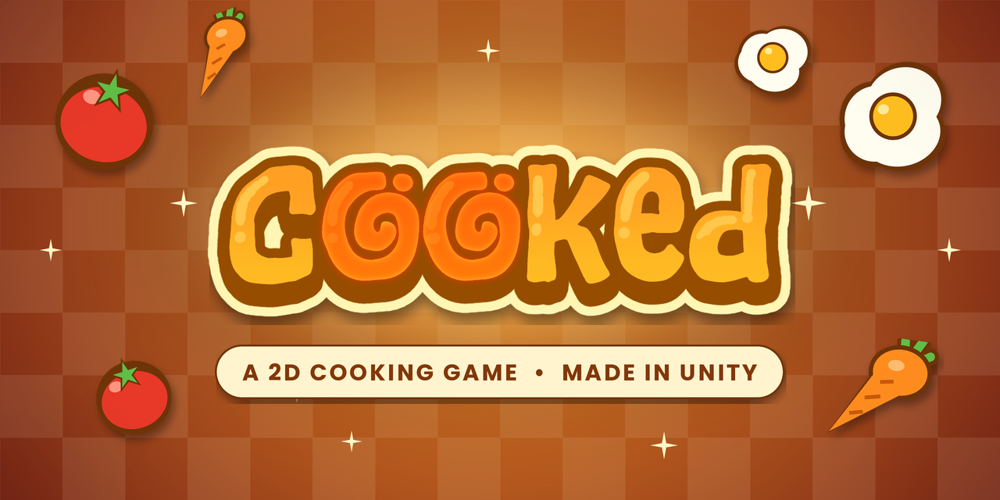
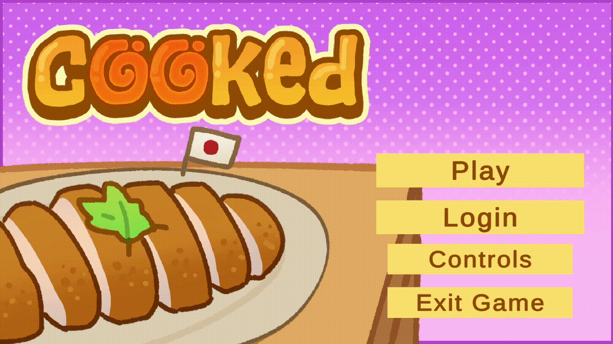

# COOKED

**a 2D Asian cooking game!** 

## Description

**COOKED** is a 2D Android game made using Unity. You'll learn how to cook various Asian dishes, their origin and nutritional information.

## Gameplay

## Installation

Download the build from the repository and enjoy!

## Features
- Step by step cooking gameplay for a range of Asian dishes (featuring 6 recipes!)
- The origin and background of each dish
- Nutritional info for every recipe for health & fitness freaks!

## Contributing

Contributions currently limited due to this being a university project.

## Authors and acknowledgment

- Design and programming: Carleen, Brooke, Sienna, Hashem, Joan. Made for our University course project.
- Art: Sienna

## License

[MIT](https://choosealicense.com/licenses/mit/)
Art assets are © Sienna + Brooke.

## Project status

Active
